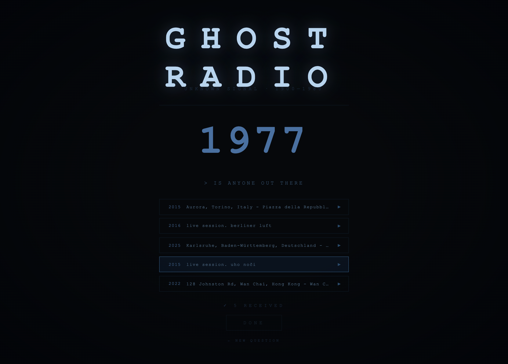

# Ghost Radio

A Go service that turns the Internet Archive into a spirit box. You ask a question and the station sweeps across decades of public-domain recordings: old-time radio, LibriVox readings, spoken-word archives, and the audio tracks of old Flash cartoons. It cuts words and short phrases out of those recordings, stitches them into sentence-shaped "transmissions" from many different voices and plays them back as your answer.



## How it works

The backend is a pipeline of long-running goroutines connected by buffered channels. When a downstream stage falls behind, the channel fills up and the stage before it waits.

```
Fetcher ──▶ Scanner ──▶ Processor pool (8 workers) ──▶ Session manager ──▶ HTTP / SSE
  │            │               │                              │
  IA search    random walk     ffmpeg analysis + cutting,     assembles pieces into
  + metadata   through time    whisper.cpp transcription      sentence-shaped composites
```

| Stage | Package | What it does |
|---|---|---|
| **Fetcher** | `internal/fetcher` | Rotates through Internet Archive search queries across speech-heavy collections. It resolves each item's metadata to pick the best streamable file (MP3/Ogg, with video containers as a fallback), skips access-restricted items and backs off when rate-limited. |
| **Scanner** | `internal/scanner` | The "station dial." It keeps a `currentYear` that does a random walk between 1900 and 1980: mostly small drifts, with an occasional large jump. It ignores anything dated outside that range, picks media weighted by how close each item's year is to the dial and emits `ClipJob`s for 12 s analysis windows, with sometimes a burst of static instead. |
| **Processor** | `internal/processor` | A worker pool that shells out to `ffmpeg`. Each job downloads a 12 s window once, then ffmpeg measures its loudness every 20 ms and its spectral centroid. Windows whose timbre is too steady to be speech (music, mostly) are dropped. Pauses are found relative to the window's own noise floor, and the stretches between them become word/phrase pieces, labelled *opening*, *middle*, *ending* or *whole* by the pauses around them. Pieces get 15–30 ms anti-click fades, and about 5% are reversed for an EVP effect. Pink-noise gaps come from ffmpeg's `anoisesrc`. |
| **Transcriber** | `internal/transcribe` | Optional. Runs whisper.cpp's `whisper-cli` on each speech window for per-word text, timings and confidence. Confident text is attached to pieces, and punctuation and capitals re-label their roles: a piece ending in `.` or `?` ends a sentence. |
| **Grammar** | `internal/grammar` | A small dictionary-plus-suffix part-of-speech tagger and a table of which parts of speech can follow which, used to judge the join between two pieces ("the \| old man" yes, "the \| went" no). |
| **Cache** | `internal/cache` | A disk cache for the normalized 12 s windows that persists across restarts. The scanner snaps offsets to the same 5 s grid the keys use, so revisiting a region skips the download. Writes are atomic (temp file + rename), and a `nil` cache is a valid no-op. |
| **Session manager** | `internal/session` | The only consumer of processor output. It fans each piece out to every active listener session. Each session pools pieces by role and assembles phrases (opening, 1–3 middles, ending) with short word gaps and longer phrase gaps, preferring joins that are grammatical, transcribed and from a different recording. It publishes 7–10 s composites until it has five. |
| **Server** | `internal/server` | Standard-library `net/http` with Go 1.22 method/path routing. It serves a [templ](https://templ.guide) page, a JSON endpoint to open a session, a Server-Sent Events stream announcing each composite as it lands, and an endpoint that serves the MP3 bytes. |

Go never decodes or encodes audio itself. All signal processing happens in `ffmpeg` subprocesses (and speech recognition in `whisper-cli`), bounded by `context` timeouts so a slow remote seek can't stall a worker. Go only reads the numbers and words they report.

### Design notes

- **Concurrency through channels and context.** Every stage exposes `Run(ctx) error` and stops cleanly on `SIGINT`/`SIGTERM` through `signal.NotifyContext`.
- **Single-writer state.** A session's pools and assembly buffer are only touched by the manager goroutine, so they need no lock. Only the finished composites, which HTTP handlers read, sit behind an `RWMutex`.
- **Continuity over accuracy.** Transcription is best-effort: without it (or when Whisper fails) pieces are joined by their pause-based roles alone. When a session can't find a grammatical piece and a pool fills up, it relaxes the rules rather than going silent.
- **Calibrated, not guessed.** The speech/music threshold and pause lengths were measured on labelled old-time radio, LibriVox, comedy LPs and 78rpm records; the numbers are in the constant comments.
- **Deterministic randomness.** The scanner runs from a seeded `math/rand` source, so a run can be reproduced.

## API

| Method | Path | Description |
|---|---|---|
| `GET` | `/` | Web UI |
| `POST` | `/session` | Open a listening session → `{"id": "..."}` |
| `GET` | `/session/{id}/events` | SSE stream: one `clip` event per composite (`index`, `identifier`, `title`, `year`), then `done` |
| `GET` | `/clip/{id}/{n}` | MP3 bytes for composite `n` |
| `DELETE` | `/session/{id}` | Stop and discard a session |

## Running it

Requirements: Go 1.24+ and `ffmpeg` on your `$PATH`.

```bash
go run ./cmd/station
# open http://localhost:8080
```

To enable transcription locally, install whisper.cpp and point the station at an English model:

```bash
brew install whisper-cpp
curl -L -o ggml-base.en.bin https://huggingface.co/ggerganov/whisper.cpp/resolve/main/ggml-base.en.bin
GHOST_RADIO_WHISPER_MODEL=$PWD/ggml-base.en.bin go run ./cmd/station
```

Or with Docker (the image includes ffmpeg, whisper-cli and the `base.en` model):

```bash
docker compose up --build
```

Encoded clips are cached in your OS cache directory (`~/Library/Caches/ghost-radio` on macOS). Set `GHOST_RADIO_CACHE_DIR` to override it.

The first session after a cold start can take a little while, because the fetcher has to fill its buffer from archive.org before the scanner has anything to tune into.

## Project layout

```
cmd/station/          entry point: wires the pipeline together
internal/fetcher/     Internet Archive search + metadata client
internal/scanner/     random-walk "dial" and clip selection
internal/processor/   ffmpeg worker pool: speech check, pause detection, piece cutting
internal/transcribe/  whisper-cli wrapper (per-word text, timing, confidence)
internal/grammar/     part-of-speech tags and junction rules
internal/cache/       on-disk window cache
internal/session/     per-listener phrase assembly
internal/server/      HTTP handlers and templ UI
internal/logger/      leveled logging
```

## Content

All audio is streamed directly from the [Internet Archive](https://archive.org) and comes from public-domain or openly licensed collections. Nothing is redistributed or stored beyond the local clip cache.
